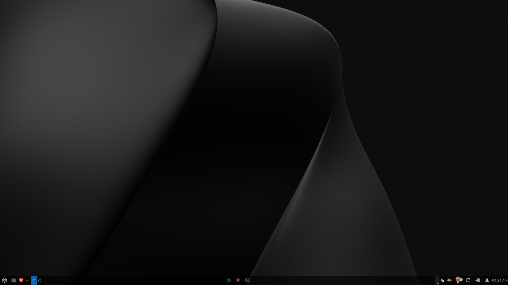

# Linux Workbench

A personal collection of Linux tweaks, themes, scripts and optimization notes for turning a stock Ubuntu/Debian desktop into a faster, prettier and more usable workstation.

Everything in this repository is designed for **Linux desktops** (primarily Ubuntu and its derivatives). Some parts target **X11**, some target **Wayland**, and some simply wrap command-line tools you already have installed.

---

## Preview



> The screenshot above lives in [`assets/`](assets/) and shows the customized desktop this workbench is built around.

---

## What's inside?

| Folder | What it is | Documentation |
| --- | --- | --- |
| [`quick scripts /`](quick%20scripts%20/) | Small helper scripts for daily tasks: CPU governor, webcam preview, Android-in-a-window, AudioRelay virtual mic, color picker, cursor reset | [docs/quick-scripts.md](docs/quick-scripts.md) |
| [`boot animation/`](boot%20animation/) | A Plymouth boot splash theme, `cuts_alt`, by Aditya Shakya | [docs/boot-animation.md](docs/boot-animation.md) |
| [`grub theme/`](grub%20theme/) | `BlackSwan` GRUB boot-menu theme (zipped) | [docs/grub-theme.md](docs/grub-theme.md) |
| [`Future-cyan-cursors/`](Future-cyan-cursors/) | A complete X11/Wayland cursor theme (111 cursors) | [docs/cursor-theme.md](docs/cursor-theme.md) |
| [`keybindings for broken laptop keys/`](keybindings%20for%20broken%20laptop%20keys/) | Remaps dead/broken laptop keys with `xmodmap` | [docs/keybindings.md](docs/keybindings.md) |
| [`Linux-debloat-optimization-guide-main/`](Linux-debloat-optimization-guide-main/) | A written guide for debloating and optimizing Ubuntu (TRIM, ZSWAP, swappiness, journald, services) | [docs/debloat-guide.md](docs/debloat-guide.md) |
| [`assets/`](assets/) | Screenshots and media used in the documentation | — |

---

## Quick start

Clone the repository somewhere convenient:

```bash
git clone git@github.com:obaidullahrion/linux-workbench.git
cd linux-workbench
```

> **A note on folder names:** several directories contain spaces, and `quick scripts ` has a **trailing space** in its name. Always quote paths:
>
> ```bash
> cd "quick scripts "
> bash "quick scripts /cpuboost.sh"
> ```

Most scripts are plain Bash and can be inspected before running:

```bash
# Read first, then run
less "quick scripts /webcam.sh"
bash "quick scripts /webcam.sh"
```

Scripts that change system state (`ufw`, `cpufreq-set`, `systemctl`) use `sudo` internally and will ask for your password.

---

## Documentation index

| Document | Description |
| --- | --- |
| [Quick Scripts](docs/quick-scripts.md) | Every helper script: purpose, dependencies, usage and caveats |
| [Boot Animation](docs/boot-animation.md) | Install, test, customize and remove the Plymouth theme |
| [GRUB Theme](docs/grub-theme.md) | Install the BlackSwan GRUB theme safely |
| [Cursor Theme](docs/cursor-theme.md) | Apply the Future-cyan cursor theme on X11, Wayland, GNOME, KDE and more |
| [Keybindings](docs/keybindings.md) | Remap broken laptop keys; keycode reference table |
| [Debloat & Optimization Guide](docs/debloat-guide.md) | Command reference for the included Ubuntu optimization guide |
| [Troubleshooting](docs/troubleshooting.md) | Common problems and how to recover |

---

## Requirements at a glance

| Component | Needs |
| --- | --- |
| Quick scripts | Bash, plus per-script tools (see [docs/quick-scripts.md](docs/quick-scripts.md)) |
| Plymouth theme | `plymouth`, `plymouth-themes`, `initramfs-tools` |
| GRUB theme | GRUB 2 (`grub-common`, `grub2-common`) |
| Cursor theme | An X11 or Wayland desktop environment |
| Keybindings | X11 + `xmodmap` (does **not** work on Wayland) |
| Debloat guide | Ubuntu/Debian system with `systemd`, `apt`, an SSD |

---

## Safety and philosophy

This repository touches **boot loaders, kernel parameters, system services and firewall rules**. Read a script before you run it, keep a backup of the files you edit, and make sure you have a way to boot a recovery environment.

Good habits:

- Back up `/etc/default/grub` before editing it.
- Test boot-theme changes before rebooting (`plymouth --show-splash`).
- Don't disable services you don't understand (see the warnings in the debloat guide).
- Scripts are written for a personal setup; review hard-coded values such as CPU core counts and device paths.

---

## Folder-by-folder summary

### Quick scripts

| Script | One-line summary |
| --- | --- |
| `cpuboost.sh` | Interactive CPU governor selector for cores 0–3 |
| `webcam.sh` | Floating, mirrored webcam preview with `mpv` |
| `startandroid.sh` | Launch Waydroid inside a Weston window with firewall rules |
| `stopandroid.sh` | Stop Waydroid/Weston and revert firewall rules |
| `audiorelay-start.sh` | Create a virtual microphone sink for AudioRelay |
| `audiorelay-stop.sh` | Remove the virtual mic and AudioRelay firewall rules |
| `colorpicker.sh` | Launch `gpick` for 60 seconds, then close it |
| `onekoreset.sh` | Kill the `oneko` cat and restore the normal cursor |

Full details: [docs/quick-scripts.md](docs/quick-scripts.md).

### Boot animation

A Plymouth script theme (`cuts_alt`) that plays a 41-frame animation while the system boots, plus password/question prompts. GPLv3, by Aditya Shakya ([@adi1090x](https://github.com/adi1090x)).

Full details: [docs/boot-animation.md](docs/boot-animation.md).

### GRUB theme

`BlackSwan.zip` contains a GRUB 2 theme with a full-screen background, per-distro icons (Arch, Ubuntu, Fedora, Windows, …), and an animated selection style.

Full details: [docs/grub-theme.md](docs/grub-theme.md).

### Future-cyan cursors

A complete cursor theme with 111 cursor files, including animated busy/wait cursors. The theme's display name is **`Future-cyan Cursors`** (note the space), even though the folder is `Future-cyan-cursors`.

Full details: [docs/cursor-theme.md](docs/cursor-theme.md).

### Broken laptop key keybindings

An `xmodmap` script that maps physical keycodes to replacement symbols — useful when individual keys on a laptop keyboard have died. **X11 only.**

Full details: [docs/keybindings.md](docs/keybindings.md).

### Debloat & optimization guide

A standalone guide covering multimedia codecs, SSD TRIM, swappiness, ZSWAP, journald limits, boot-time analysis and service management. The original Markdown guide is in [`Linux-debloat-optimization-guide-main/README.md`](Linux-debloat-optimization-guide-main/README.md); the summarized/annotated version is in [docs/debloat-guide.md](docs/debloat-guide.md).

---

## Credits and licenses

- **cuts_alt Plymouth theme** — © Aditya Shakya ([@adi1090x](https://github.com/adi1090x)), GPLv3. See [`boot animation/cuts_alt/LICENSE`](boot%20animation/cuts_alt/LICENSE).
- **BlackSwan GRUB theme** — third-party GRUB theme; see the source/upstream project for its license.
- **Future-cyan Cursors** — third-party cursor theme distributed in this repository.
- **Debloat guide and quick scripts** — personal notes and scripts, provided as-is for educational purposes.

Check each upstream project before redistributing its assets publicly.

---

## Contributing

This is a personal workbench, but improvements are welcome:

1. Keep scripts POSIX/Bash-friendly and readable.
2. Document any new script in [docs/quick-scripts.md](docs/quick-scripts.md) and add it to the table above.
3. Never commit secrets, machine-specific device paths, or personal data.

---

*Last updated: November 2026*
